# Entrega final: Fiver Cable, cobro digital en campo

**Proyecto:** Transformación digital del proceso de cobro en campo  
**Curso:** Seminario de Tecnologías de Información 2026, Universidad Mariano Gálvez de Guatemala  
**Empresa:** Fiver Cable, proveedor de internet y televisión por fibra óptica  
**Equipo:** Hazel Ruvi Perez Carcamo (0900-21-13727), Byron Enrique Morales (0900-1015162), Luis Oswaldo Reyes (0900-98-2342)  
**Repositorio:** Azure Repos `Fiver Cable DevOps`  
**Fecha de las evidencias:** 10 de octubre de 2026

Todas las capturas y salidas de este documento provienen de la ejecución real del sistema en el equipo del grupo. Las cuentas y los datos que aparecen son de demostración (`db/init/02_seed.sql`). No se muestran contraseñas, tokens, claves ni cadenas de conexión.

## Contenido

1. [Proceso seleccionado](#1-proceso-seleccionado)
2. [Solución desarrollada](#2-solución-desarrollada)
3. [Código fuente](#3-código-fuente)
4. [Puesta en producción](#4-puesta-en-producción)
5. [Pruebas](#5-pruebas)
6. [Manual de usuario](#6-manual-de-usuario)
7. [Seguridad de la solución](#7-seguridad-de-la-solución)
8. [Resultados](#8-resultados)
9. [Conclusiones y anexos](#9-conclusiones-y-anexos)
10. [Guion de la exposición](#10-guion-de-la-exposición-10-minutos)

---

## 1. Proceso seleccionado

### Proceso actual

Cuando un cliente de Fiver Cable tiene facturas pendientes, su servicio puede quedar en estado *Moroso* o *Suspendido*. Durante una visita técnica, el cliente suele querer pagar en ese momento. Hoy el técnico recibe el dinero, lo anota de forma manual y el pago se registra después en oficina. Hasta que facturación procesa ese registro, la factura sigue apareciendo como pendiente y el cliente sigue sin servicio.

### Problema identificado

- El pago queda registrado con retraso, porque depende de que el técnico lo entregue y alguien lo transcriba.
- La transcripción permite errores de monto, de factura o de cliente.
- No existe un comprobante con identificador único en el momento del cobro.
- La conciliación diaria entre lo cobrado en campo y lo registrado es manual.
- Una misma factura puede quedar expuesta a cobrarse dos veces.

### Justificación de la automatización

Es un proceso frecuente, con reglas claras (una factura, un monto, un método de pago) y directamente ligado al ingreso de la empresa. Si se registra en el momento y en una sola operación, se elimina la transcripción, se impide el cobro duplicado, se emite el recibo de inmediato y el cierre diario se calcula solo. Por eso el equipo lo eligió como proceso prioritario de la transformación digital.

> Alcance de la medición: el equipo no levantó una línea base cuantitativa (tiempos o errores del proceso manual). Los beneficios de la sección 8 se presentan como mejoras del flujo comprobadas en el sistema, no como ahorro medido.

---

## 2. Solución desarrollada

### Descripción

Es una plataforma de cuatro microservicios con un **portal web de operaciones** (`/portal`), responsive para celular y computadora. Cada usuario ve un menú según su rol. El proceso central es el **cobro en campo**: el técnico inicia sesión, busca al cliente, ve su ficha y sus facturas pendientes, elige el método de pago y registra el cobro. El sistema valida el pago, lo guarda, marca la factura como *Pagado*, emite un recibo imprimible y permite **reactivar el servicio** del cliente en el mismo momento.

### Pantallas por rol

| Rol | Pantallas |
|---|---|
| **Técnico** | Inicio (jornada e indicadores), Cobro en campo, Clientes, Tickets (tomar y cerrar), Red y equipos (estado de ONU, registro), Mi perfil |
| **Secretaría** | Inicio, Clientes (registro de suscriptores), Pago en oficina, Facturación (emitir factura FEL), Tickets (crear para clientes), Cierre diario, Mi perfil |
| **Jefatura** | Panel de indicadores, Cierre diario y recaudación por día, Clientes, Tickets, Red, Auditoría (todo en solo lectura), Mi perfil |
| **Administrador** | Todas las anteriores y además Personal (alta de cuentas con rol) |
| **Cliente (suscriptor)** | Mi cuenta (saldo, plan, equipo y señal), Mis facturas, Soporte técnico (reportar falla y seguimiento), Planes, Mi perfil |

### Funcionalidades principales

| Funcionalidad | Servicio | Endpoint |
|---|---|---|
| Inicio de sesión con JWT y 5 roles | `ms_auth` | `POST /api/auth/login` |
| Cambio de contraseña autenticado | `ms_auth` | `PUT /api/auth/cambiar-password` |
| Registro de suscriptores con validación de NIT/DPI y política de contraseña | `ms_auth` | `POST /api/auth/registro` |
| Búsqueda de clientes y alta de personal | `ms_auth` | `GET /api/clientes`, `POST /api/usuarios` |
| Cambio de estado del servicio con transiciones válidas y auditoría | `ms_auth` | `PATCH /api/clientes/{id}/estado`, `GET /api/auditoria` |
| Emisión y consulta de facturas FEL | `ms_pagos` | `POST /api/facturas`, `GET /api/facturas` |
| **Registro de cobro con recibo y registro de quién cobró** | `ms_pagos` | `POST /api/pagos` |
| Historial de cobros, cierre diario e indicadores | `ms_pagos` | `GET /api/pagos`, `/api/pagos/cierre-diario`, `/api/resumen` |
| Planes, equipos ONU, señal óptica y estado en la OLT | `ms_catalogo` | `/api/planes`, `/api/onus`, `/api/onus/criticas`, `/api/onus/estado` |
| Tickets de soporte con prioridad automática, SLA, asignación y cierre | `ms_pedidos` | `/api/tickets`, `/api/tickets/{id}/tomar`, `/api/tickets/{id}/cerrar` |

### Tecnologías

| Capa | Tecnología |
|---|---|
| Lenguaje y API | Python 3.11, FastAPI, Pydantic |
| Base de datos | PostgreSQL 16, con un esquema por microservicio |
| Seguridad | PyJWT (HS256), bcrypt |
| Contenedores | Docker, Docker Compose |
| CI/CD | Azure Pipelines (`azure-pipelines.yml`), Jenkins (`Jenkinsfile`) |
| Nube (staging) | Azure Container Apps, Azure Container Registry, Azure Database for PostgreSQL (`infra/azure/deploy-staging.sh`) |
| Pruebas | Pytest, httpx, Selenium, pytest-cov, pytest-html, Ruff |

### Arquitectura

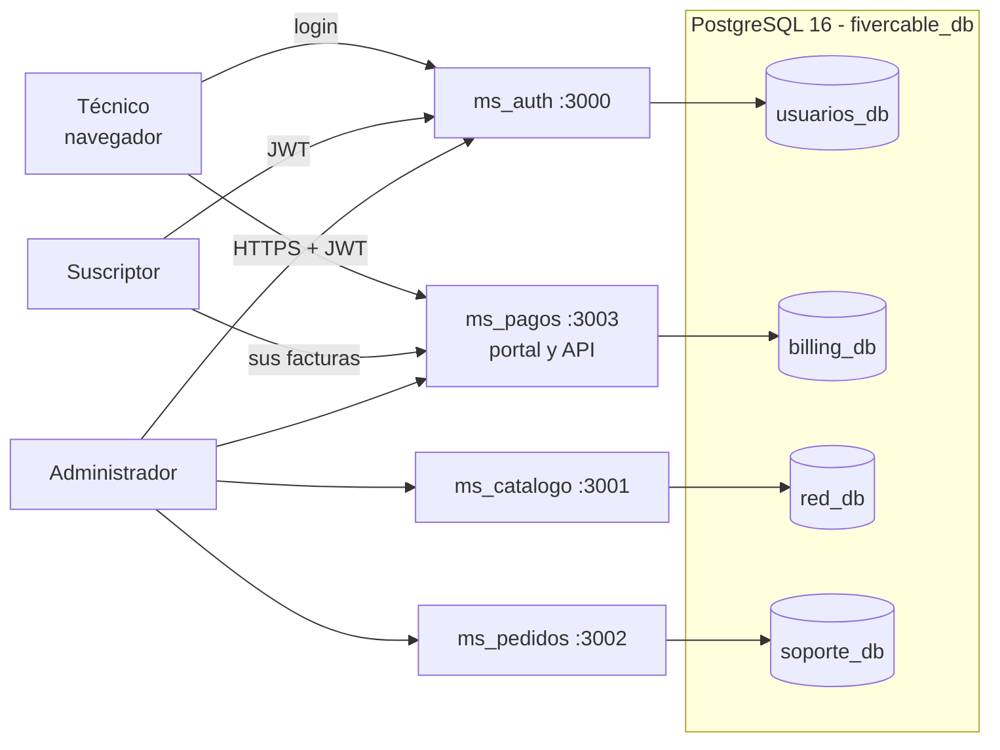

### Flujo principal (cobro en campo)

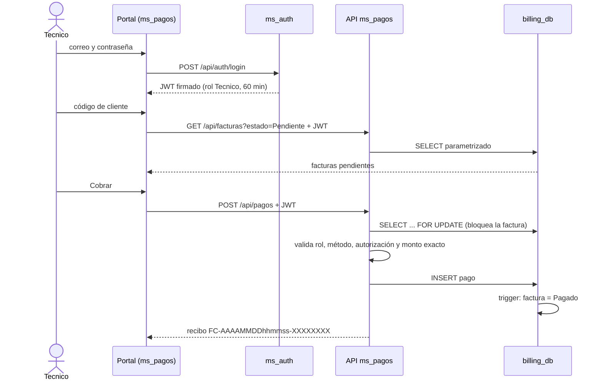

---

## 3. Código fuente

El código está en este repositorio. Su organización:

```
src/
  common/base.py      JWT, roles, pool de conexiones, CORS, manejo de errores y /health
  ms_auth/            main.py (API) + logic.py (reglas puras: NIT, contraseña, transiciones)
  ms_catalogo/        planes, ONU, señal óptica
  ms_pedidos/         tickets, prioridad y SLA
  ms_pagos/           main.py (API), logic.py (monto, método, id de transacción), portal.html
db/init/              01_schema.sql (esquemas, restricciones, vistas, triggers) y 02_seed.sql
docker/               un Dockerfile por servicio (imagen slim, usuario sin privilegios, healthcheck)
tests/                unit, integration, system, acceptance, security, performance
infra/azure/          despliegue de staging en Azure
docs/evidencias/      capturas, reporte de pruebas y script que las genera
```

### Componentes principales

- **`src/common/base.py`**: cada servicio se crea con `crear_app()`, que registra el pool de conexiones, el CORS restringido por la variable `CORS_ORIGINS`, un manejador que oculta las trazas internas y el endpoint `/health`. `usuario_actual()` valida el JWT y `requiere_rol()` protege las rutas por rol. `get_conn()` fija el `search_path` del esquema del servicio en cada transacción.
- **Separación API/lógica**: cada `main.py` contiene solo las rutas HTTP y el SQL. Las reglas de negocio están en `logic.py`, que no depende de la base de datos y por eso se puede probar con pruebas unitarias.
- **`src/ms_pagos/main.py` → `registrar_pago`**: es el núcleo del proceso. Exige el rol Técnico, Secretaría o Administrador, valida el método y el código de autorización, bloquea la factura con `FOR UPDATE`, rechaza facturas que no estén pendientes, exige que el monto coincida con la factura e inserta el pago con un identificador generado por `secrets` y el correo del usuario que cobró (`registrado_por`).
- **`db/init/01_schema.sql`**: contiene las restricciones `CHECK` sobre estados, roles y montos, las claves foráneas, el trigger `trg_procesar_pago_exitoso` (que marca la factura como pagada), el trigger `trg_auditar_cliente` (que registra en la auditoría cada cambio de estado con el usuario de la aplicación que lo hizo) y la vista `vw_cierre_diario_pagos`.
- **`src/ms_pagos/portal.html`**: es la aplicación web de una sola página (HTML, CSS y JavaScript sin dependencias de compilación). Tiene un menú por rol, consume las APIs de los cuatro servicios, escapa todo dato antes de insertarlo en el HTML y guarda el token solo en memoria (no usa `localStorage`). Es responsive: en celular el menú se abre con un botón y las tablas se muestran como tarjetas.

---

## 4. Puesta en producción

### Entorno utilizado

La aplicación se ejecuta en contenedores con Docker Compose: PostgreSQL 16, Redis y los cuatro microservicios, cada uno con su healthcheck. Para la demostración se usó Docker Desktop 29.4 sobre Windows 11.

```powershell
Copy-Item .env.example .env      # luego reemplazar los valores de demostración
docker compose up -d --build --wait
docker compose ps
```

Salida obtenida:

```
NAME             STATUS                    PORTS
fiver_postgres   Up 30 seconds (healthy)   0.0.0.0:5432->5432/tcp
fiver_redis      Up 30 seconds             0.0.0.0:6379->6379/tcp
ms_auth          Up 18 seconds (healthy)   0.0.0.0:3000->3000/tcp
ms_catalogo      Up 18 seconds (healthy)   0.0.0.0:3001->3001/tcp
ms_pagos         Up 18 seconds (healthy)   0.0.0.0:3003->3003/tcp
ms_pedidos       Up 18 seconds (healthy)   0.0.0.0:3002->3002/tcp
```

| URL | Uso |
|---|---|
| `http://localhost:3003/portal` | Portal web de operaciones (todos los roles) |
| `http://localhost:3000/docs` … `:3003/docs` | Documentación OpenAPI de cada servicio |
| `http://localhost:300X/health` | Estado del servicio y de su conexión a la base de datos |

### Proceso de despliegue (CI/CD)

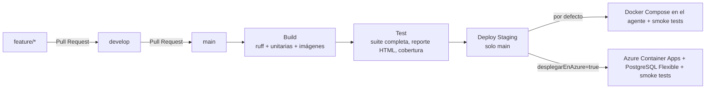

- En `azure-pipelines.yml`, cada push o PR a `develop`/`main` ejecuta las etapas Build y Test. Solo `main` llega a Deploy Staging, que se ejecuta en el Environment `fivercable-staging`.
- `infra/azure/deploy-staging.sh` es idempotente. Crea el grupo de recursos, ACR, PostgreSQL Flexible Server y Container Apps, carga el esquema, publica las imágenes y verifica `/health` de los cuatro servicios. La contraseña de PostgreSQL y el secreto JWT se generan en cada despliegue y se guardan como *secrets* de Container Apps (`secretref:`), no en el repositorio.

### Evidencias de funcionamiento

| `/health` ms_auth | `/health` ms_pagos |
|---|---|
| 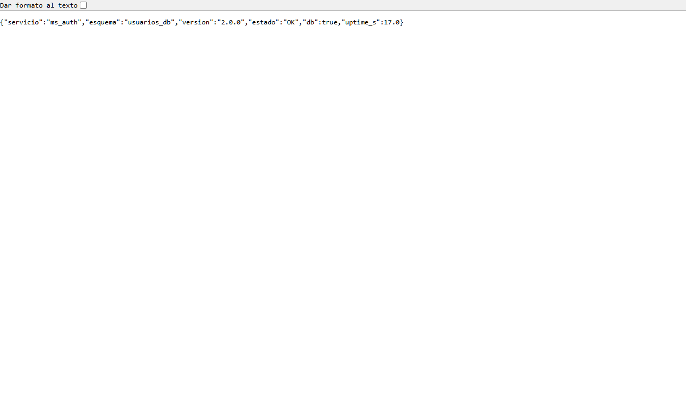 | 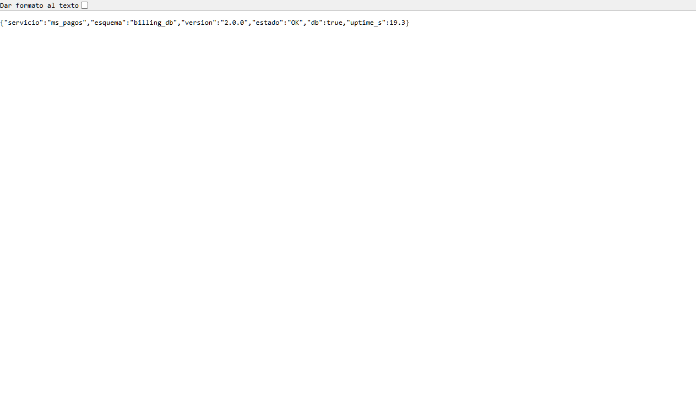 |

Las capturas de `ms_catalogo` y `ms_pedidos` también están en [evidencias/capturas](evidencias/capturas/). Las cuatro respuestas muestran `"estado":"OK","db":true`.

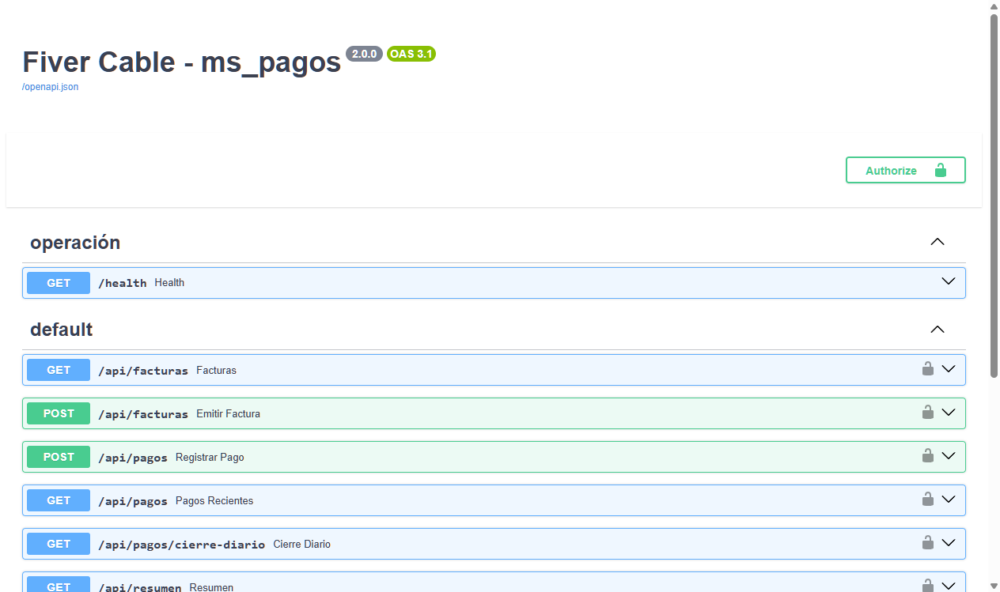

> **Azure (completar si se ejecutó):** si el equipo corrió el pipeline con `desplegarEnAzure = true`, agregar aquí la captura del run exitoso (número de build y fecha), la URL `https://ms-pagos.<…>.azurecontainerapps.io/portal` y `/health` de los cuatro servicios, ocultando el ID de suscripción. Si no se ejecutó, la demostración en clase se presenta como **ambiente Docker de staging** y Azure como despliegue configurado.

---

## 5. Pruebas

La suite usa Pytest. Cada caso lleva el ID del plan de pruebas (CP-01 a CP-43), que se muestra en el reporte HTML.

```powershell
python -m pytest --html=reports/reporte-pruebas.html --self-contained-html --cov=src
```

### Resultados de la ejecución del 10/10/2026

| Tipo | Marcador | Resultado |
|---|---|---|
| Unitarias (reglas de negocio, contraseña, JWT, pool) | `unit` | 30 aprobadas |
| Integración con la base de datos (triggers, procedimientos, restricciones) | `integration` | 5 aprobadas |
| Sistema (flujo de cobro completo por API, cobro duplicado, monto) | `system` | 9 aprobadas |
| Aceptación con Selenium (prototipo: cliente, técnico, administrador, jefatura, secretaría) | `acceptance` | 8 aprobadas |
| Seguridad (token, roles de los 5 perfiles, aislamiento, inyección SQL, auditoría) | `security` | 9 aprobadas |
| Rendimiento | `performance` | 1 aprobada, **1 fallida** |
| **Total** | | **62 aprobadas, 1 fallida** |

- **Análisis estático:** `ruff check` dio *All checks passed*.
- **Rendimiento:** CP-25 (latencia individual) aprobó, con un promedio de 6.3 ms y p95 de 8.5 ms. CP-26 (200 solicitudes con 20 concurrentes) **falló**: el p95 fue de unos 1.5 s frente a un límite de 900 ms, aunque hubo **0 errores**. Todas las solicitudes respondieron bien, pero en cola. La causa probable es el pool de conexiones limitado a 5 por servicio y Docker Desktop en Windows. El ajuste se detalla en la sección 9.
- **Cobertura:** 43 % del total. Las reglas de negocio (`logic.py`) tienen entre 91 % y 100 %. Los `main.py` aparecen con 0 % porque las pruebas de sistema y seguridad los ejecutan dentro de los contenedores, donde la herramienta de cobertura del host no los mide; sí se ejercitan en esas pruebas.
- **Recorrido de la interfaz:** se recorrieron con Selenium las 34 pantallas de los 5 roles en computadora (1440 px) y en celular (390 px), sin errores de carga ni desbordes horizontales.

Reporte completo: [evidencias/reporte-pruebas.html](evidencias/reporte-pruebas.html), con los tokens de demostración ocultos. Las capturas de Selenium del prototipo están en [evidencias/capturas-prototipo](evidencias/capturas-prototipo/).

### Pruebas funcionales de la aplicación web

| Caso | Rol | Resultado esperado | Obtenido | Evidencia |
|---|---|---|---|---|
| Buscar facturas pendientes del cliente 2 | Técnico | Ficha del cliente y FEL-A-1002 / FEL-A-1003 | ✔ | M03 |
| Cobrar con tarjeta sin código de autorización | Técnico | Rechazo | ✔ *"El método de pago requiere código de autorización"* | S03 |
| Cobrar FEL-A-1002 en efectivo | Técnico | Recibo y estado Pagado | ✔ Recibo `FC-20261010190623-B5044294` | M04 |
| Cobrar todo el saldo de un cliente Moroso y reactivar | Técnico | Servicio Activo, ONU en línea, evento de auditoría | ✔ | M05, S05 |
| Cobrar de nuevo FEL-A-1002 por API | Técnico | 409 | ✔ *"La factura ya está en estado Pagado"* | Anexo A |
| Registrar suscriptor, emitir factura y cobrar en oficina con tarjeta | Secretaría | Cliente nuevo, factura FEL y recibo | ✔ | M13, CP-41 |
| Consultar panel, cierre y auditoría sin opciones de modificación | Jefatura | Solo lectura | ✔ | M12, CP-40 |
| Crear cuenta de técnico y registrar ONU | Administrador | Cuenta y equipo creados | ✔ | M11 |
| Ver su cuenta y reportar una falla desde el celular | Cliente | Ticket con prioridad y SLA | ✔ | M14, S04 |

Cobros registrados en la base de datos durante la ejecución, con el usuario que los hizo (extracto):

```
  id_transaccion_pasarela   | id_factura | monto_pagado |  metodo_pago  |        registrado_por
----------------------------+------------+--------------+---------------+------------------------------
 FC-HIST-0002               |         10 |       299.00 | Tarjeta       | secretaria@fivercable.com
 FC-20261010190623-B5044294 |          2 |       499.00 | Efectivo      | tecnico.campo@fivercable.com
 FC-20261010190624-371689B0 |          4 |       299.00 | Efectivo      | tecnico.campo@fivercable.com
 FC-20261010190625-C4E10ACE |          5 |       299.00 | Efectivo      | tecnico.campo@fivercable.com
 FC-20261010190917-4383F912 |         16 |       199.00 | Tarjeta       | secretaria@fivercable.com
```

---

## 6. Manual de usuario

### Requisitos para acceder

- Un navegador actualizado (Chrome, Edge o Firefox), en computadora o celular.
- La dirección del portal: `http://localhost:3003/portal` en el ambiente local, o la URL de staging que entregue el equipo.
- Una cuenta que entrega Administración. El menú que verá depende de su rol: Cliente, Técnico, Secretaría, Jefatura o Administrador.

> Para la demostración hay cuentas de prueba de cada rol (variables `TEST_*` de `.env.example`). Son solo para el ambiente de demostración y no deben usarse en producción.

### Iniciar sesión

Escriba su correo y su contraseña y seleccione **Iniciar sesión**. La contraseña nunca se muestra en pantalla.


Si los datos son incorrectos, el sistema responde con *Credenciales inválidas* y no indica cuál de los dos campos falló. Si olvidó su contraseña, seleccione **¿Olvidaste tu contraseña?** y solicite el restablecimiento a Administración.

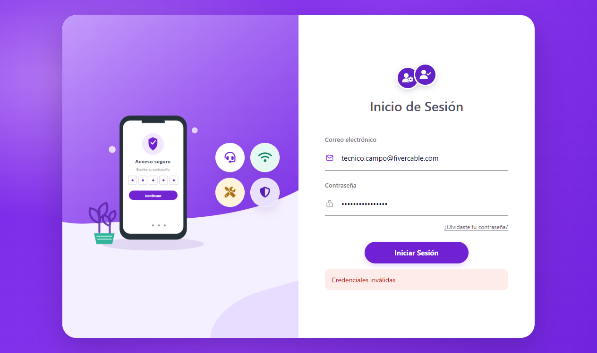

Al entrar verá el **Inicio** de su rol, con indicadores y accesos rápidos. En computadora el menú está a la izquierda; en celular se abre con el botón de menú (☰).

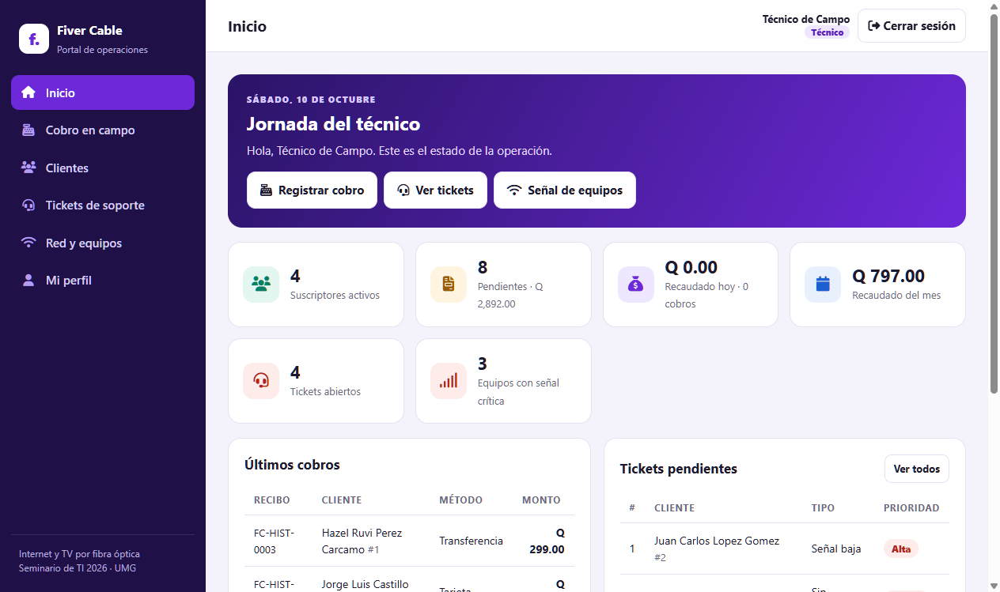

### Técnico: cobro en campo

1. Seleccione **Cobro en campo** en el menú.
2. Escriba el **código de cliente**. Si no lo sabe, use **¿No sabe el código? Buscar cliente**.
3. Elija el **método de pago**. Para Tarjeta o Transferencia escriba el **código de autorización** del voucher.
4. Seleccione **Buscar facturas**. Verá la ficha del cliente (nombre, dirección, teléfono y estado del servicio) y sus facturas pendientes.

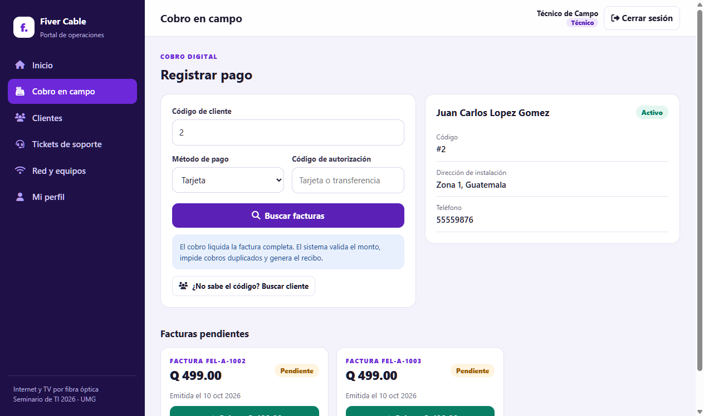

5. Confirme con el cliente la factura y el monto, y seleccione **Cobrar Q …** una sola vez. Si falta información, el sistema rechaza el cobro y explica el motivo:

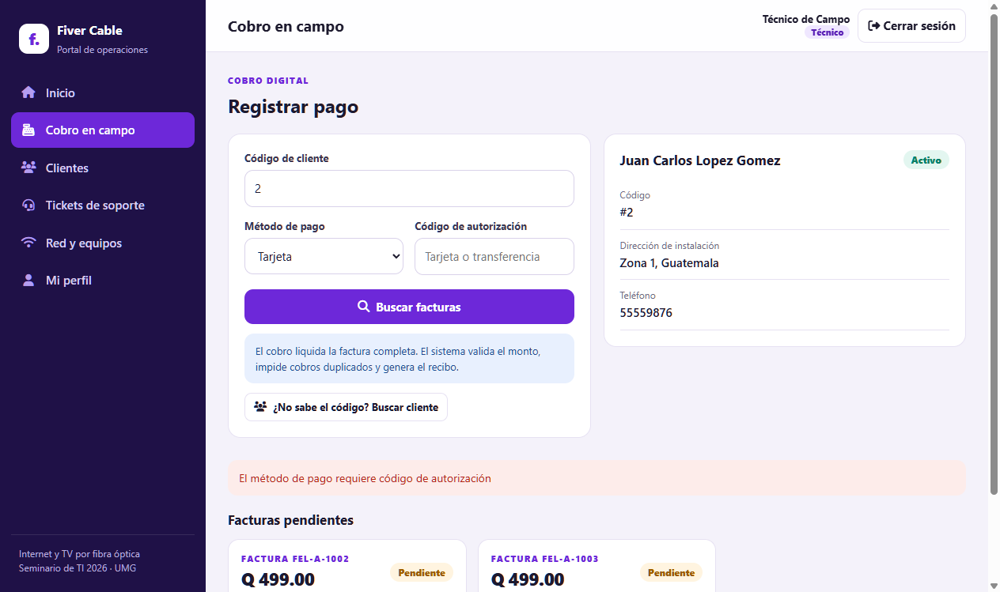

6. Cuando el cobro se registra, la factura cambia a **Pagado** y aparece el **recibo** con número único, que puede **Imprimir** o dictar al cliente.

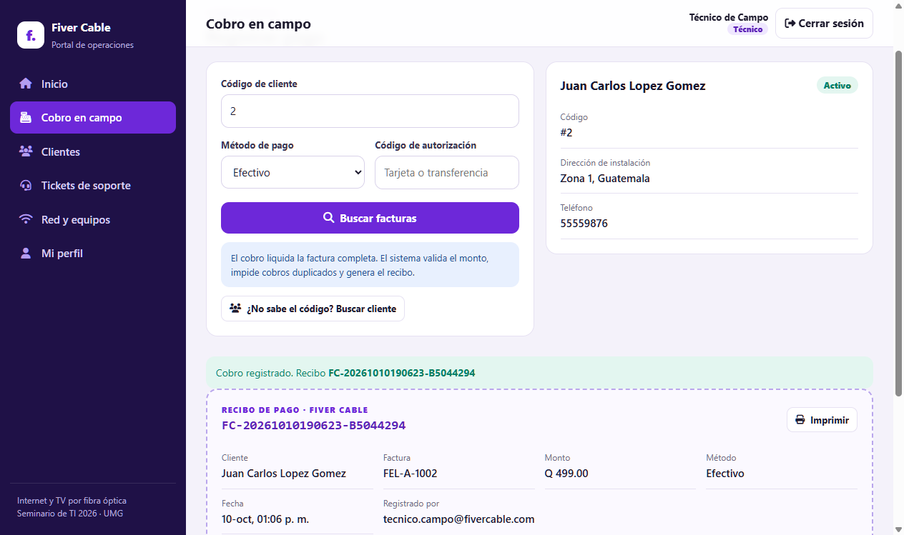

7. Si el cliente estaba **Moroso** o **Suspendido** y ya no tiene saldo, aparece **Reactivar servicio**. Al seleccionarlo, el servicio pasa a Activo y el equipo ONU queda en línea.

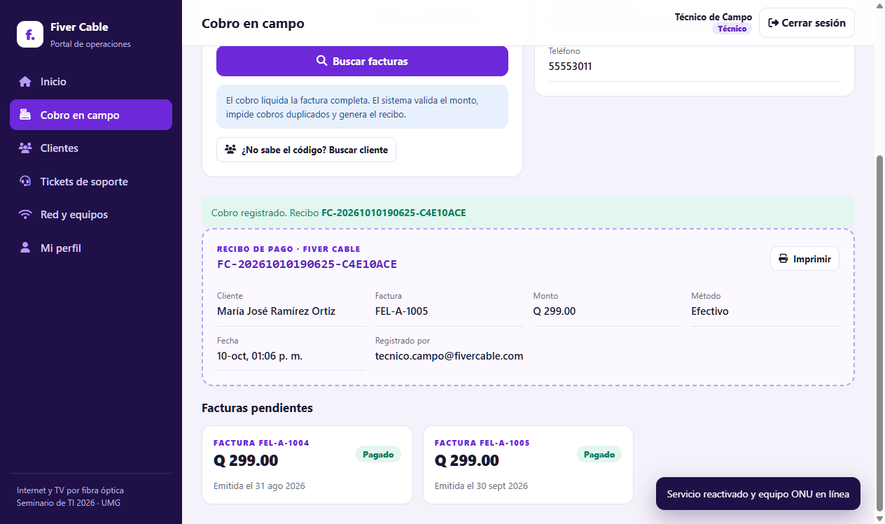

### Técnico: tickets y red

- **Tickets de soporte:** muestra los tickets pendientes con su prioridad. Use **Tomar** para asignárselo y **Cerrar** al resolverlo.
- **Red y equipos:** lista las ONU de los clientes con su potencia y una etiqueta de señal (*Normal*, *Crítica baja*, *Crítica alta*). Puede cambiar el estado de un equipo en la OLT o **Registrar ONU** nueva.

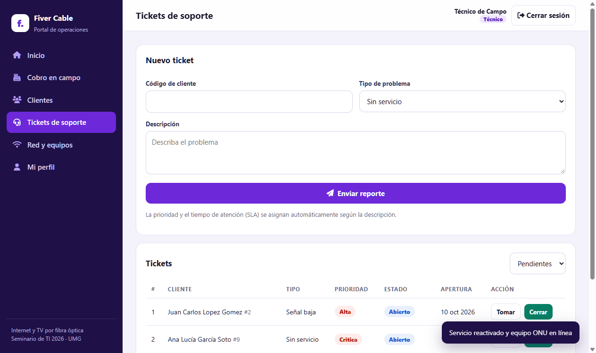

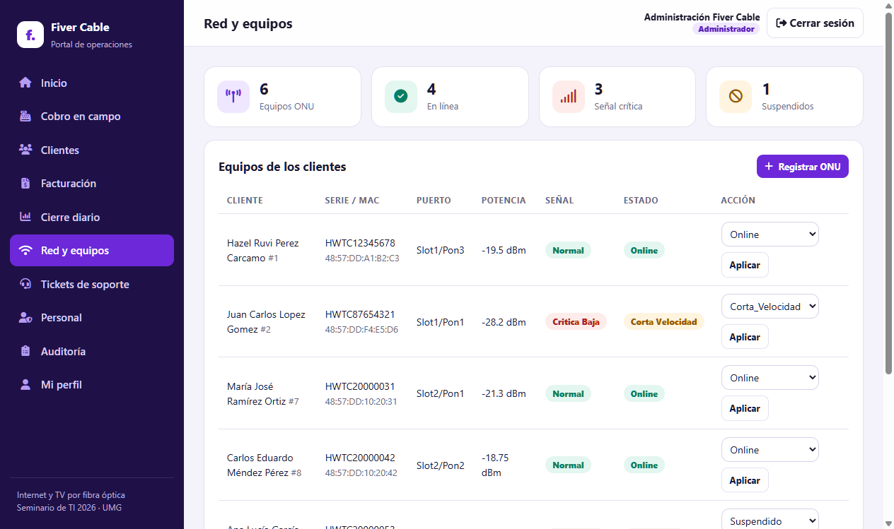

### Secretaría: atención de oficina

- **Clientes → Registrar suscriptor:** complete nombres, DPI o NIT, teléfono, correo, plan, dirección y una contraseña inicial. El sistema valida el DPI/NIT y la política de contraseña, y asigna un código de cliente.
- **Facturación → Emitir factura:** escriba el código de cliente, elija el plan (llena el monto) y seleccione **Emitir factura FEL**.
- **Pago en oficina:** funciona igual que el cobro en campo.
- **Tickets → Nuevo ticket:** registre la falla que reporta un cliente por teléfono.

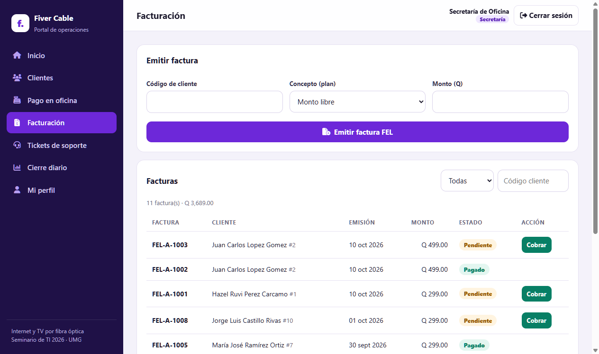

### Administrador

Tiene todas las opciones anteriores y además:

- **Clientes:** al seleccionar un cliente ve su ficha completa (datos, plan, saldo, equipo, facturas y tickets) y puede **Cambiar estado** del servicio. Solo se ofrecen transiciones válidas.
- **Personal:** crea cuentas de Técnico, Secretaría, Jefatura o Administrador.
- **Auditoría:** muestra cada cambio de estado del servicio, quién lo hizo y cuándo.

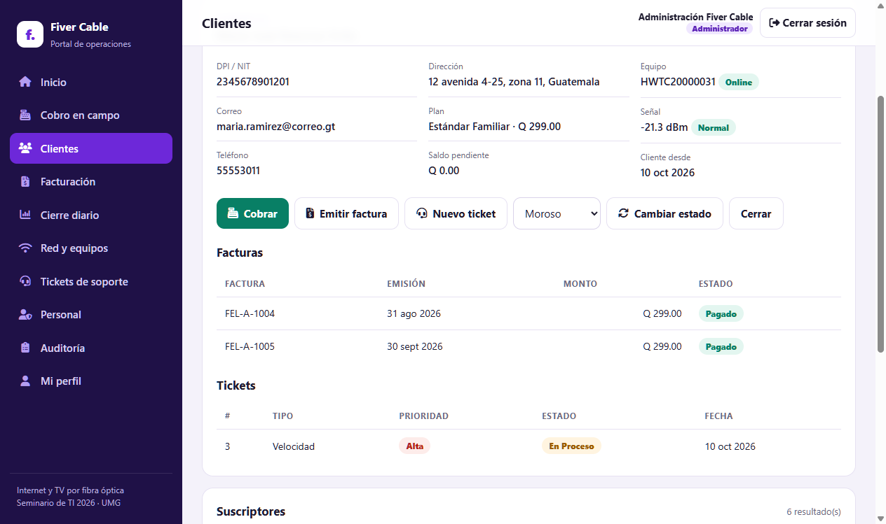

### Jefatura: supervisión

El **Panel de jefatura** muestra suscriptores activos, facturas pendientes, recaudación del día y del mes, tickets abiertos y equipos con señal crítica. **Cierre diario** muestra la recaudación por método y por día, y el detalle de cada cobro con quién lo registró; se puede **Imprimir**. Todo es de solo lectura.

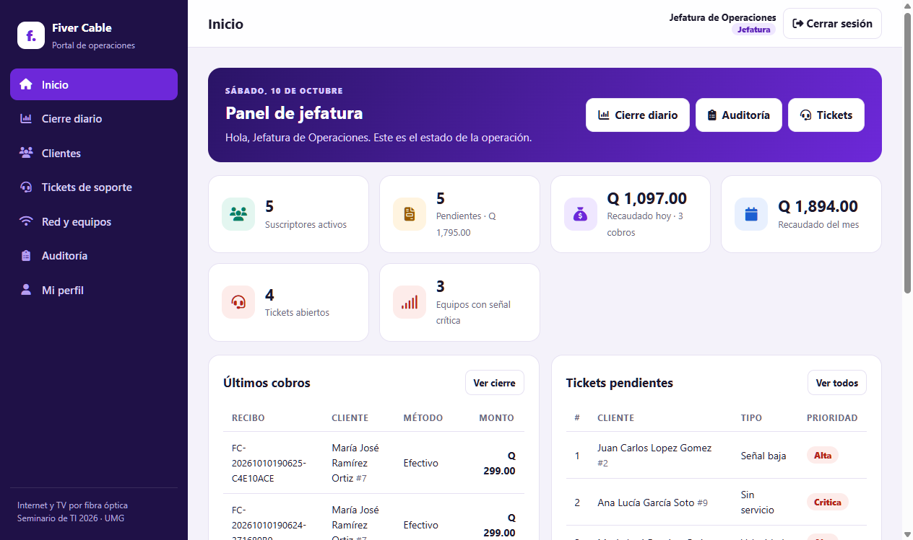

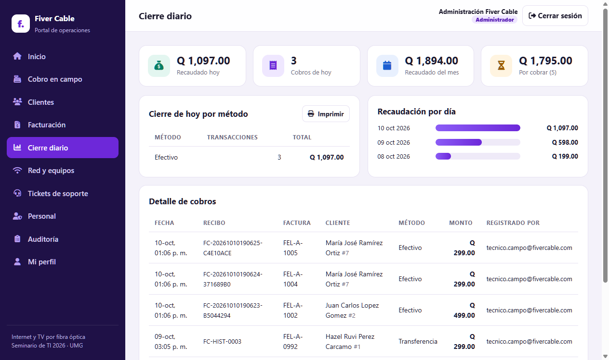

### Cliente

En **Inicio** ve su saldo pendiente, su plan, el estado de su equipo y sus últimos reportes. En **Mis facturas** consulta su historial. En **Soporte técnico** reporta una falla: el sistema asigna la prioridad y el tiempo máximo de atención. Todo funciona desde el celular.

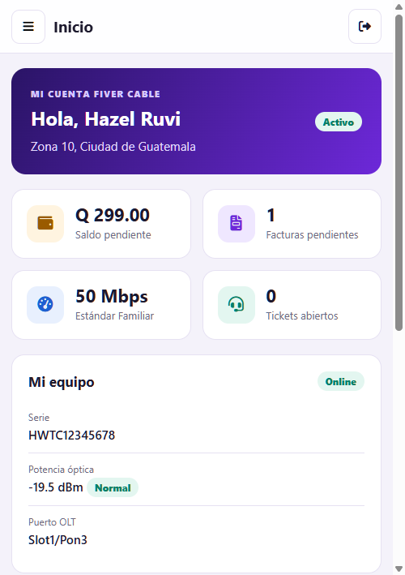

### Cambiar la contraseña y cerrar sesión

En **Mi perfil** escriba la contraseña actual, la nueva y la confirmación. La nueva debe tener al menos 8 caracteres, con una mayúscula, una minúscula y un número, y debe ser distinta de la actual. Use **Cerrar sesión** al terminar, sobre todo en equipos compartidos. La sesión expira sola a los 60 minutos.

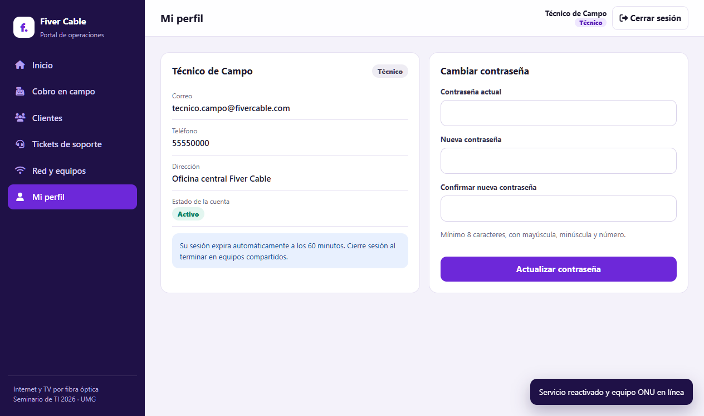

### Buenas prácticas de uso seguro

- No comparta su cuenta ni anote la contraseña en el equipo.
- No repita un cobro si hubo un error de red. Busque primero la factura: si ya no aparece como pendiente, el cobro quedó registrado.
- Verifique la identidad del cliente antes de cobrar.
- Reporte a Administración cualquier cobro que no reconozca en el cierre diario.

---

## 7. Seguridad de la solución

En esta sección, cada control tiene su evidencia real: una captura, código, configuración o el resultado de una prueba.

### 7.1 Requerimientos de seguridad

| Requerimiento | Cómo se cumple | Evidencia |
|---|---|---|
| **Autenticación** | Login con contraseña verificada con bcrypt. Se emite un JWT HS256 que expira a los 60 min y se valida su firma en cada solicitud. | `src/common/base.py` (`crear_token`, `usuario_actual`), S01, S02, Anexo A, CP-22 |
| **Autorización** | Cinco roles. `requiere_rol(...)` en cada operación sensible (grupos `PERSONAL`, `COBRADORES` y `OPERACION` en `base.py`). El suscriptor solo puede consultar lo propio y Jefatura solo lee. | `src/common/base.py`, `ms_*/main.py`, Anexo A (403), S04, CP-23, CP-40 a CP-42 |
| **Privacidad** | El hash de la contraseña nunca se devuelve. Un suscriptor no puede ver datos de otro cliente. Las capturas usan datos ficticios. | `obtener_cliente` en `ms_auth/main.py`, Anexo A |
| **Integridad** | El monto debe coincidir con la factura. La factura se bloquea con `FOR UPDATE`. Hay restricciones `CHECK` y FK, y el trigger cambia el estado. Una factura no se cobra dos veces. | `ms_pagos/main.py`, `01_schema.sql`, Anexo A (409, 422) |
| **Disponibilidad** | Healthchecks en Docker y `/health`. El pool de conexiones es acotado y devuelve 503 con `Retry-After` si se agota. Container Apps limita las réplicas. | `base.py`, `docker-compose.yml`, `deploy-staging.sh`, E01 |

### 7.2 Arquitectura y UML: roles, permisos, límites de confianza y flujos críticos

**Matriz de roles y permisos (lo que la API aplica realmente):**

| Operación | Cliente | Técnico | Secretaría | Jefatura | Administrador |
|---|---|---|---|---|---|
| Iniciar sesión / cambiar su contraseña | ✔ | ✔ | ✔ | ✔ | ✔ |
| Ver su perfil, facturas, tickets y equipo | ✔ solo lo propio | ✔ | ✔ | ✔ | ✔ |
| Ver datos de otros clientes | ✘ 403 | ✔ | ✔ | ✔ | ✔ |
| Registrar cobro | ✘ 403 | ✔ campo | ✔ oficina | ✘ 403 | ✔ |
| Emitir factura | ✘ 403 | ✘ 403 | ✔ | ✘ 403 | ✔ |
| Cambiar el estado del servicio | ✘ 403 | ✔ | ✔ | ✘ 403 | ✔ |
| Operar equipos ONU / tomar y cerrar tickets | ✘ 403 | ✔ | ✘ 403 | ✘ 403 | ✔ |
| Cierre diario e indicadores | ✘ 403 | ✔ | ✔ | ✔ | ✔ |
| Auditoría | ✘ 403 | ✘ 403 | ✘ 403 | ✔ | ✔ |
| Crear cuentas de personal | ✘ 403 | ✘ 403 | ✘ 403 | ✘ 403 | ✔ |

La interfaz muestra a cada rol solo su menú, pero **la decisión la toma siempre la API**: aunque alguien llame al endpoint directamente, recibe 403 (CP-23, CP-40, CP-41, CP-42).

**Diagrama de casos de uso por rol:**

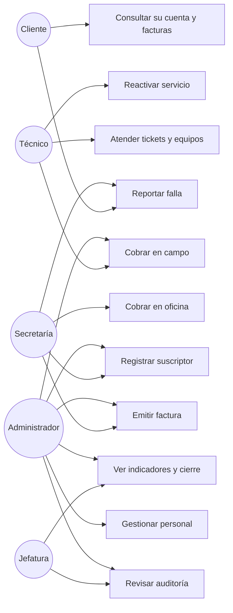

**Límites de confianza:**

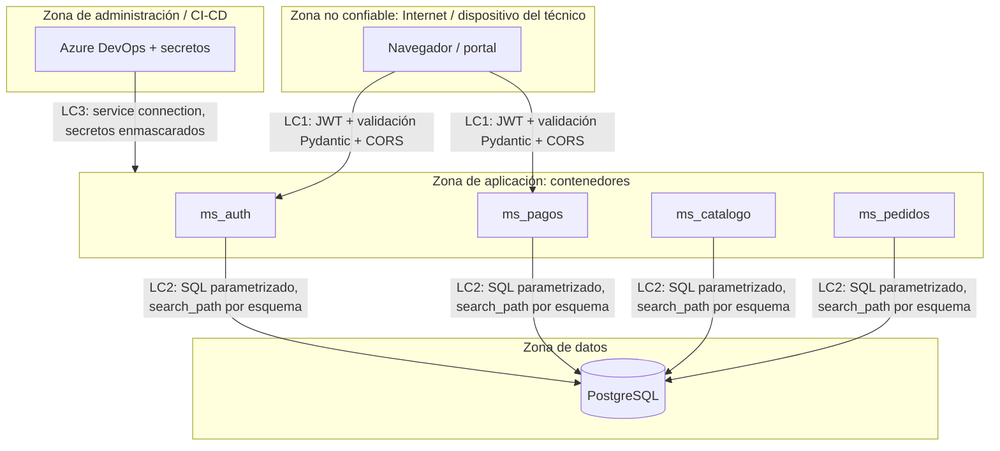

- **LC1:** ninguna entrada del navegador se considera confiable. Toda ruta de negocio exige un JWT válido, Pydantic valida los tipos y rangos, y CORS solo permite los orígenes configurados.
- **LC2:** los servicios no concatenan SQL y cada uno trabaja dentro de su esquema.
- **LC3:** los secretos de despliegue solo existen en Azure DevOps y en Container Apps.

**Flujo crítico (registro del cobro) con sus controles:** este es el diagrama de secuencia de la sección 2. Los controles se aplican en este orden: JWT válido → rol permitido → método permitido → autorización presente si es tarjeta o transferencia → factura existente y bloqueada → estado Pendiente → monto exacto → inserción → trigger.

### 7.3 Datos y base de datos

| Tema | Implementación | Evidencia |
|---|---|---|
| Protección de la información | Contraseñas con bcrypt (cost 10, con sal). Las consultas no devuelven el hash. | Consulta: `hash_bcrypt = $2b$10$…` en los 3 usuarios (Anexo B) |
| Integridad | `CHECK` sobre estados, roles y montos (`monto_pagado > 0`). `FOREIGN KEY ... ON DELETE RESTRICT` de pagos a facturas. `UNIQUE` en correo, `uuid_sat` y MAC. | `db/init/01_schema.sql`, CP integración (MAC única) |
| Auditoría | El trigger `trg_auditar_cliente` registra el estado anterior, el nuevo y el usuario de la aplicación en `auditoria_usuarios`. Cada pago guarda `registrado_por`. | Anexo B, S05, CP-43 |
| Separación | Un esquema por microservicio. `get_conn` fija `SET LOCAL search_path` solo al esquema del servicio. | `src/common/base.py` |
| Credenciales | Se leen de variables de entorno o de *secrets*. `.env` está en `.gitignore`. En Azure, la contraseña de PostgreSQL es aleatoria en cada despliegue. | `.gitignore`, `deploy-staging.sh` |
| Mínimo privilegio | **Pendiente:** los cuatro servicios se conectan con el mismo usuario administrador. Plan: un rol de PostgreSQL por esquema con `GRANT` limitado. | Hallazgo H2 |
| Respaldos | **Pendiente en local.** Azure PostgreSQL Flexible Server incluye respaldos automáticos (7 días por defecto). Falta documentar una prueba de restauración. | Hallazgo H4 |

### 7.4 DevOps: accesos, repositorio, secretos, dependencias y CI/CD

| Tema | Implementación | Evidencia |
|---|---|---|
| Control de acceso al repositorio | Repositorio privado en Azure Repos. Flujo `feature/*` → PR a `develop` → PR a `main`. Solo `main` despliega. | `README.md`, `azure-pipelines.yml` (`condition: ... refs/heads/main`) |
| Secretos | No hay secretos reales en el repositorio. `.env` está ignorado. El pipeline enmascara los valores generados (`##vso[task.setsecret]`) y Container Apps usa `secretref:`. Jenkins toma `JWT_SECRET` de `credentials()`. | `deploy-staging.sh`, `Jenkinsfile`, `git check-ignore .env` → `.gitignore:2` |
| Dependencias | Versiones fijadas con `==` en `requirements*.txt`. Imagen base `python:3.11-slim`. | `requirements.txt` |
| Contenedores | Los servicios corren como un usuario sin privilegios (`USER appuser`) y tienen `HEALTHCHECK`. | `docker/Dockerfile.*` |
| Seguridad del pipeline | Calidad antes de construir: Ruff y pruebas unitarias con fallo rápido. La suite de seguridad corre en cada build. Deploy en un Environment (`fivercable-staging`) que admite aprobaciones manuales. | `azure-pipelines.yml` |
| Pendiente | Escaneo de vulnerabilidades de dependencias e imágenes (`pip-audit`, Trivy) y políticas de rama obligatorias configuradas en Azure Repos. | Hallazgo H5 |

### 7.5 Aplicación: entradas, sesiones, permisos, errores y registros

| Tema | Implementación | Evidencia |
|---|---|---|
| Validación de entradas | Modelos Pydantic: `id_factura > 0`, teléfono `^\d{8,15}$`, longitudes máximas. NIT con dígito verificador, correo y política de contraseña en `logic.py`. Métodos de pago en lista blanca. | Anexo A: inyección `1 OR 1=1` → 422, "Bitcoin" → 422, contraseña débil → 422 |
| Inyección SQL | Todas las consultas usan parámetros `%s` de psycopg. El nombre del esquema se compone con `sql.Identifier`. | `ms_*/main.py`, CP-24 |
| XSS | El portal escapa todos los datos con `escapar()` antes de insertarlos en el DOM | `portal.html` |
| Sesiones | JWT con `exp` de 60 min y algoritmo fijo (`algorithms=["HS256"]`, no acepta `none`). El token vive solo en memoria y se borra al cerrar sesión. | `base.py`, S01, Anexo A (token manipulado → 401) |
| Permisos | Dependencias `requiere_rol` y verificación de propiedad (`sub == id_cliente`) | Anexo A (403) |
| Manejo de errores | El manejador global devuelve `{"detail":"Error interno del servicio"}` sin traza. Los mensajes de login no revelan si el correo existe. | `base.py`, S02 |
| Registros | Auditoría de cambios de estado en la base de datos. Cada pago guarda la fecha, el método y el identificador, y la API devuelve `cobrado_por`. Docker conserva los logs de cada contenedor (el pipeline los archiva). | Anexo B, `azure-pipelines.yml` (`logs-servicios.txt`) |

### 7.6 Usuario y producción: uso seguro y pruebas de los controles

El uso seguro se explica en el manual (sección 6, "Buenas prácticas"). Los controles se comprobaron así:

| Control probado | Prueba | Resultado |
|---|---|---|
| Acceso sin token | S01 y CP-22 | 401 *Token requerido* |
| Token alterado | Anexo A y CP-22 | 401 *Token inválido* |
| Suscriptor consulta otro cliente | Anexo A y CP-23 | 403 |
| Suscriptor intenta cobrar o listar clientes | Anexo A, S04, CP-23 y CP-42 | 403; el menú del cliente no ofrece esas opciones |
| Jefatura intenta cobrar, emitir factura o cambiar estado | CP-40 | 403 (solo lectura) |
| Secretaría intenta operar la red o ver auditoría | CP-41 | 403 |
| Auditoría identifica al usuario de la aplicación | CP-43 y S05 | El evento registra el correo del técnico |
| Inyección SQL | Anexo A y CP-24 | 422, sin ejecutar SQL |
| Monto alterado | Anexo A | 422 |
| Cobro duplicado | Anexo A y prueba de sistema | 409 |
| Contraseña débil / cambio sin contraseña actual | Anexo A, CP-36 a CP-38 | 422 / 401 |

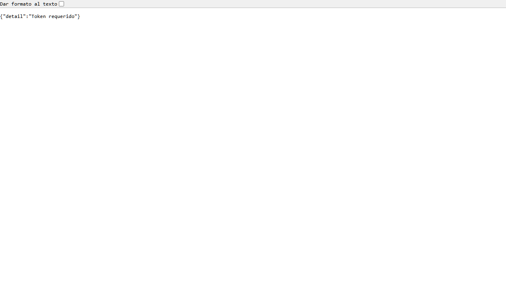

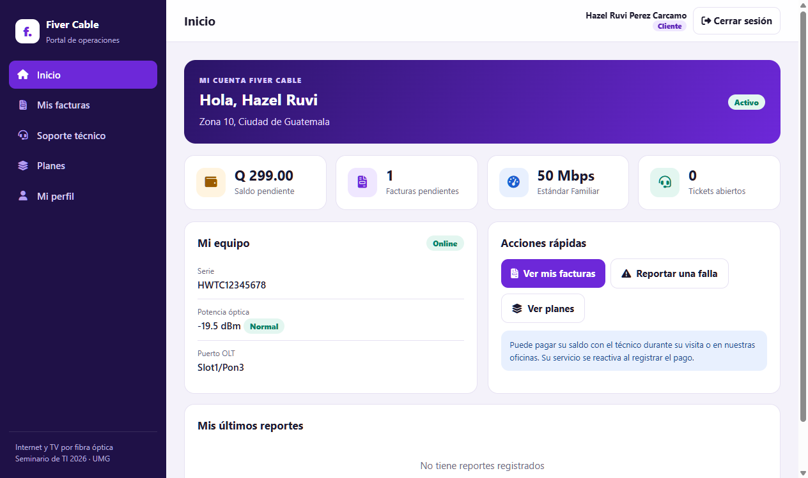

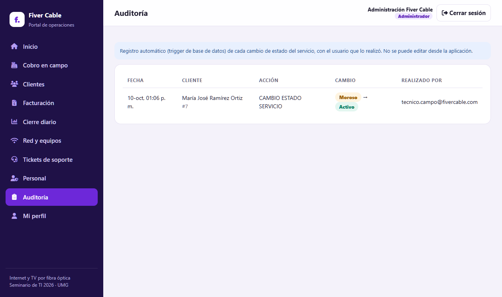

### 7.7 Hallazgos y plan de mejora (autoevaluación)

| ID | Hallazgo | Riesgo | Acción |
|---|---|---|---|
| H1 | `jwt_secret()` tiene un valor por defecto de desarrollo si falta `JWT_SECRET` | Alto si se despliega sin la variable | Hacer que el servicio no arranque si falta (en Azure ya se inyecta un secreto aleatorio) |
| H2 | Un único usuario de base de datos con privilegios de administrador para los cuatro servicios | Medio | Un rol de PostgreSQL por esquema con `GRANT` mínimos |
| H3 | No hay límite de intentos de login ni revocación de JWT tras cambiar la contraseña | Medio | Rate limiting y una lista de revocación o `token_version` |
| H4 | ~~La auditoría registraba el usuario de base de datos (`postgres`)~~ **Corregido:** la API envía el usuario con `set_config('app.usuario', …)` y el trigger lo registra (CP-43). Sigue pendiente probar la restauración de respaldos. | Bajo | Probar el *restore* |
| H5 | El pipeline no escanea vulnerabilidades. El ACR usa usuario administrador. Los cuatro servicios tienen ingreso externo. | Medio | Agregar `pip-audit` y Trivy, usar identidad administrada y dejar solo ms_pagos y ms_auth con ingreso público |
| H6 | Los valores de demostración de `.env.example` (`admin123`) | Bajo (solo local) | Reemplazarlos al crear `.env` en cualquier ambiente compartido |

---

## 8. Resultados

### Beneficios comprobados en el sistema

| Antes (manual) | Con la solución | Evidencia |
|---|---|---|
| El pago se registraba después, en oficina | Se registra en el momento del cobro | M04, tabla `pagos` |
| Transcripción de monto y factura | El monto lo valida el sistema contra la factura (422 si no coincide) | Anexo A |
| Riesgo de cobrar dos veces | Bloqueo de fila más validación de estado (409) | Anexo A |
| Sin comprobante inmediato | Recibo único `FC-…` generado con `secrets` | M04 |
| Conciliación manual | Cierre diario automático por método de pago | `vw_cierre_diario_pagos` |
| Sin rastro de cambios de servicio | Auditoría automática por trigger | Anexo B |

### Aporte a la transformación digital

- **Digitaliza un proceso de ingreso:** el cobro pasa del papel a una transacción validada y trazable.
- **Datos confiables para decidir:** el estado de las facturas y la recaudación diaria están disponibles al instante.
- **Base para escalar:** al usar microservicios, contenedores y CI/CD, se pueden agregar más procesos (soporte, inventario de red) sin rehacer la plataforma.
- **Seguridad desde el diseño:** las pruebas de seguridad forman parte del pipeline y se ejecutan en cada cambio.

---

## 9. Conclusiones y anexos

### Conclusiones

1. El cobro en campo quedó automatizado de punta a punta dentro del sistema: autenticación, consulta, validación, registro, recibo y reactivación del servicio. Alrededor de ese proceso, la aplicación web cubre la operación de los 5 roles de la empresa (cliente, técnico, secretaría, jefatura y administración) y funciona en celular y computadora sobre contenedores con los cuatro servicios sanos.
2. La seguridad se incorporó en todas las capas: API (JWT, roles, validación), base de datos (restricciones, triggers, consultas parametrizadas), contenedores (usuario sin privilegios) y pipeline (secretos, pruebas automáticas). Además se comprobó con 62 pruebas aprobadas, con ataques de prueba documentados y con permisos verificados para los 5 roles.
3. La prueba de carga concurrente (CP-26) no cumplió la meta de p95, aunque no hubo errores. Antes de producción hay que ajustar `DB_POOL_MAX_SIZE` y las réplicas y repetir la prueba en el ambiente de Azure.
4. Quedan pendientes, documentados en 7.7: secreto JWT obligatorio, mínimo privilegio en la base de datos, límite de intentos de login, respaldo probado y escaneo de dependencias. Además, la reconexión física de la ONU y la integración con SAT y con la pasarela bancaria siguen como trabajo futuro: hoy el trigger marca la factura como pagada, pero no actúa sobre la OLT.

### Anexo A. Respuestas reales de la API ante intentos indebidos

```
GET /api/facturas sin token                         -> HTTP 401 {"detail":"Token requerido"}
GET /api/facturas con token manipulado              -> HTTP 401 {"detail":"Token inválido"}
Suscriptor (cliente 1) consulta facturas cliente 2  -> HTTP 403 {"detail":"Solo puede consultar sus propias facturas"}
Suscriptor intenta POST /api/pagos                  -> HTTP 403 {"detail":"Rol sin permiso para esta operación"}
Técnico cobra Q1.00 a factura de Q299.00            -> HTTP 422 {"detail":"El monto Q1.00 no coincide con el total de la factura Q299.00"}
Técnico usa método "Bitcoin"                        -> HTTP 422 {"detail":"Método de pago no permitido"}
Técnico cobra otra vez la factura 2 (ya pagada)     -> HTTP 409 {"detail":"La factura ya está en estado Pagado"}
Inyección SQL id_cliente="1 OR 1=1"                 -> HTTP 422 int_parsing (no llega a la base de datos)
Login con contraseña incorrecta                     -> HTTP 401 {"detail":"Credenciales inválidas"}
Registro con contraseña "12345"                     -> HTTP 422 {"detail":"La contraseña no cumple la política (...)"}
Cambio de estado a "Borrado"                        -> HTTP 422 {"detail":"Estado no válido"}
```

### Anexo B. Evidencia en la base de datos

```
-- Contraseñas almacenadas como hash bcrypt (se muestra solo el prefijo)
            correo            |    rol     | hash_bcrypt
 hazel.perez@fivercable.com   | Suscriptor | $2b$10$…
 juan.lopez@gmail.com         | Suscriptor | $2b$10$…
 tecnico.campo@fivercable.com | Tecnico    | $2b$10$…
 admin@fivercable.com         | Administrador | $2b$10$…
 jefatura@fivercable.com      | Jefatura   | $2b$10$…
 secretaria@fivercable.com    | Secretaria | $2b$10$…

-- Auditoría generada por trg_auditar_cliente tras cambios de estado hechos desde la aplicación
 id | id_cliente |         accion         |       usuario_operador       |      fecha       | detalles
  1 |          7 | CAMBIO_ESTADO_SERVICIO | tecnico.campo@fivercable.com | 2026-10-10 13:06 | {"estado_nuevo": "Activo", "estado_anterior": "Moroso"}
  3 |          8 | CAMBIO_ESTADO_SERVICIO | tecnico.campo@fivercable.com | 2026-10-10 13:09 | {"estado_nuevo": "Moroso", "estado_anterior": "Activo"}
  5 |          8 | CAMBIO_ESTADO_SERVICIO | tecnico.campo@fivercable.com | 2026-10-10 13:10 | {"estado_nuevo": "Activo", "estado_anterior": "Moroso"}
```

### Anexo C. Archivos de evidencia

| Archivo | Contenido |
|---|---|
| [evidencias/capturas/](evidencias/capturas/) | Capturas de la aplicación web por rol y de la API (E = entorno, M = manual, S = seguridad) |
| [evidencias/capturas-prototipo/](evidencias/capturas-prototipo/) | Capturas automáticas de Selenium del prototipo (CP-29 a CP-39) |
| [evidencias/reporte-pruebas.html](evidencias/reporte-pruebas.html) | Reporte de Pytest de la ejecución completa |
| [evidencias/capturar_evidencias.py](evidencias/capturar_evidencias.py) | Script que regenera las capturas del portal |
| [guion-demostracion.md](guion-demostracion.md) | Guion paso a paso de la demostración en vivo |

Para regenerar las evidencias:

```powershell
docker compose down -v; docker compose up -d --build --wait
python docs/evidencias/capturar_evidencias.py
```

> Nota del entorno: si en Windows hay un PostgreSQL local escuchando en el puerto 5432, las pruebas de integración se conectan a ese servidor en lugar del contenedor. En ese caso, exponga el contenedor en otro puerto y ejecute las pruebas con `DB_PORT` apuntando a ese puerto.

---

## 10. Guion de la exposición (10 minutos)

| Tiempo | Contenido | Quién | Qué mostrar |
|---|---|---|---|
| 0:00–1:00 | Fiver Cable y el proceso de cobro en campo | Integrante 1 | Sección 1 |
| 1:00–2:00 | El problema: cobro manual, atraso, errores, cobro duplicado | Integrante 1 | Tabla "Antes / Con la solución" |
| 2:00–3:00 | Solución, arquitectura y tecnologías | Integrante 2 | Diagrama de arquitectura |
| 3:00–6:00 | **Demostración en vivo:** login de técnico → panel → cobro al cliente 7 (rechazo con tarjeta sin autorización, cobro en efectivo, recibo, reactivar servicio) → panel de jefatura → vista del cliente en celular | Integrante 2 | Portal en `:3003/portal`, ver `guion-demostracion.md` |
| 6:00–8:00 | Controles de seguridad: API sin token (401), suscriptor (403), monto alterado (422), duplicado (409), auditoría en BD, secretos en el pipeline | Integrante 3 | Anexo A, matriz de roles, límites de confianza |
| 8:00–9:00 | Pruebas y CI/CD: 62/63, CP-26 y su plan, pipeline Build → Test → Deploy | Integrante 3 | Reporte HTML, `azure-pipelines.yml` |
| 9:00–10:00 | Resultados, beneficios, pendientes y cierre | Integrante 1 | Secciones 8 y 9 |

Recomendaciones para la exposición:

- Levantar el ambiente 10 minutos antes y reiniciar los datos con `docker compose down -v; docker compose up -d --wait`, para que las facturas de demostración estén pendientes.
- Tener abiertas las capturas de `docs/evidencias/capturas` como respaldo si falla la demostración en vivo.
- No mostrar el archivo `.env` ni escribir contraseñas a la vista. Usar el gestor de contraseñas del navegador o escribirlas con la pantalla compartida pausada.
- Si se presenta Azure, mostrar solo las URL públicas y el run del pipeline, nunca la página de variables o secretos.
